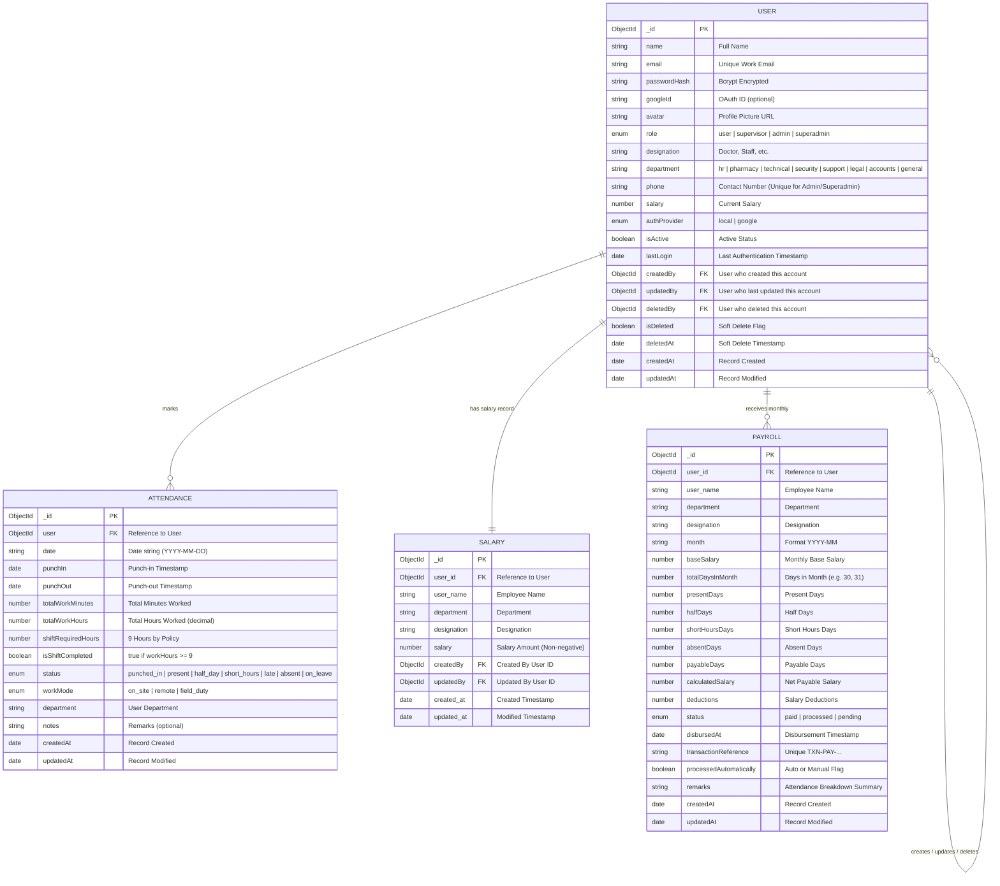
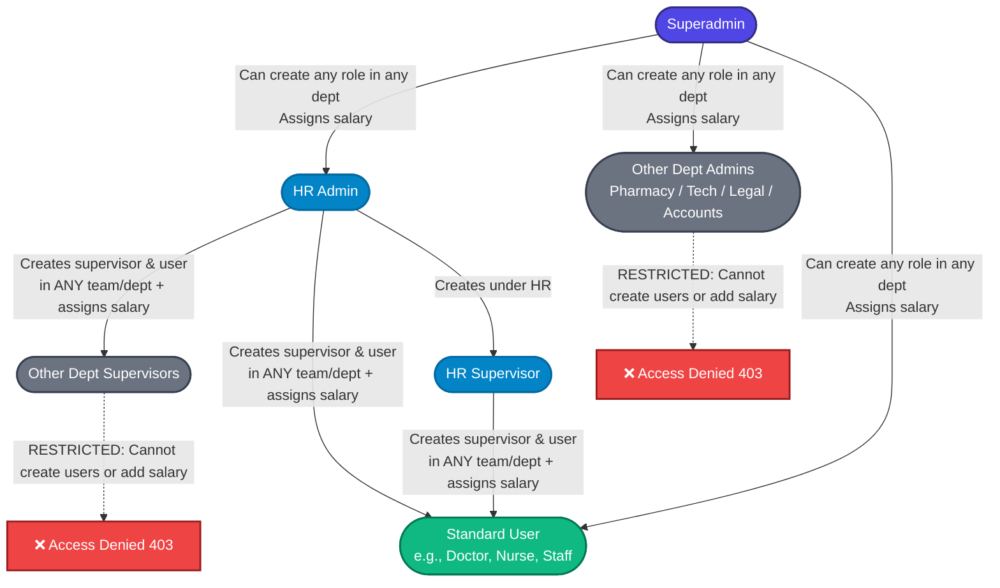
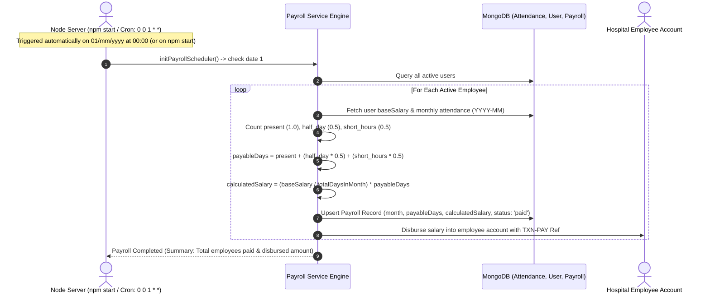
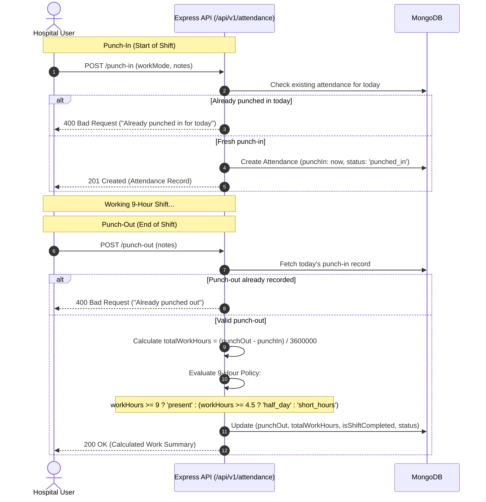

# MediPulse Hospital - User Management, Salary & Attendance System

An enterprise-grade hospital management backend system built with **Node.js**, **Express**, and **MongoDB**. Features hierarchical role-based access control (RBAC), centralized HR hiring, employee salary records management, audit logging, a 9-hour work policy attendance tracking system, and an **automated monthly attendance-based payroll distribution system**.

---

## 📌 System Architecture & Core Highlights

- **Hierarchical RBAC & Centralized Hiring**:
  - **Superadmin**: Full global view and edit capabilities across all users, salaries, and attendance in the hospital.
  - **HR Admin & HR Supervisors**: Centralized personnel management. Exclusively authorized to hire/create supervisors and users across any department, assign salary records, and view/manage only users created by them.
  - **Other Department Admins & Supervisors**: Strictly **restricted** from creating users or assigning salary.
- **Dedicated Salary Records Table (`salaries`)**:
  - Full CRUD operations with fields: `user_id`, `user_name`, `department`, `designation`, `salary`, `created_at`, `updated_at`.
  - Automatically initialized during user creation and synchronized on profile edits.
- **Automated Monthly Attendance-Based Payroll (`payrolls`)**:
  - Automatically runs on date **01 of every month** (`01/mm/yyyy`) via scheduled cron and startup check on `npm start`.
  - Computes salary per employee based on monthly attendance records:
    - **`present`**: 1.0 payable day
    - **`half_day`**: 0.5 payable day
    - **`short_hours`**: 0.5 payable day
    - **`punched_in`** (no punch-out): 0.5 payable day
  - Formula: `calculatedSalary = Math.round((baseSalary / totalDaysInMonth) * payableDays)`.
  - Maintains month-wise historical records with unique transaction references (`TXN-PAY-YYYYMM-...`) and dispatches to accounts.
- **Soft Delete & Full Audit Trail**: Tracks `createdBy`, `updatedBy`, `deletedBy`, and `deletedAt` for compliance and record history.
- **Attendance System (9-Hour Policy)**: Real-time Punch-In / Punch-Out with automated work hour calculation, shift completion flags, and statuses (`present`, `half_day`, `short_hours`, `late`, `punched_in`).
- **RESTful API Versioning**: All routes prefixed under `/api/v1/`.

---

## 🗄️ Database Schema Diagram



---

## 👥 Role Hierarchy & Personnel Creation Workflow



---

## 💰 Automated 01/mm/yyyy Monthly Payroll Workflow



---

## ⏱️ Attendance System & 9-Hour Shift Workflow



---

## 📊 Summary of Permissions & Visibility Matrix

| Role | Create Users & Assign Salary | Target Department | User List Visibility (`GET /users`) | Payroll Records Access |
| :--- | :--- | :--- | :--- | :--- |
| **Superadmin** | `user`, `supervisor`, `admin`, `superadmin` | Any Department | **All Users** in entire hospital | Full access to process, view, audit all payrolls |
| **HR Admin** | `user`, `supervisor` | **Any Team / Department** | **Only users created by them** | Full access to trigger & view all monthly payrolls |
| **HR Supervisor** | `user`, `supervisor` | **Any Team / Department** | **Only users created by them** | Full access to view all monthly payrolls |
| **Other Dept Admin** | **Restricted (403)** | N/A | Only users created by them | View own personal salary slip (`/payroll/my`) |
| **Other Dept Supervisor**| **Restricted (403)** | N/A | Only users created by them | View own personal salary slip (`/payroll/my`) |
| **Standard User** | **Restricted (403)** | N/A | N/A | View own personal salary slip (`/payroll/my`) |

---

## 🚀 API Endpoints Overview

All endpoints are versioned with the `/api/v1/` prefix.

### 1. Authentication (`/api/v1/auth`)
| Method | Endpoint | Access | Description |
| :--- | :--- | :--- | :--- |
| `POST` | `/api/v1/auth/login` | Public | Authenticate with email & password, returns JWT token |
| `POST` | `/api/v1/auth/logout` | Private | Clears auth cookies and invalidates session |
| `POST` | `/api/v1/auth/refresh` | Public | Refreshes access token using refresh token |
| `GET` | `/api/v1/auth/google` | Public | Google OAuth 2.0 social login initiate |
| `GET` | `/api/v1/auth/google/callback` | Public | Google OAuth 2.0 callback URL |

### 2. User Management (`/api/v1/users`)
| Method | Endpoint | Access | Description |
| :--- | :--- | :--- | :--- |
| `GET` | `/api/v1/users/me` | Authenticated | Retrieve current user profile |
| `POST` | `/api/v1/users` | Superadmin, HR Admin, HR Supervisor | Create a user & initialize salary (Other depts restricted) |
| `GET` | `/api/v1/users` | Superadmin, Admin, Supervisor | List users (scoped by role rules) |
| `GET` | `/api/v1/users/:id` | Superadmin, Admin, Supervisor | Get specific user by ID |
| `PATCH` | `/api/v1/users/:id` | Superadmin, Admin, Supervisor | Update user details & salary (records `updatedBy`) |
| `DELETE` | `/api/v1/users/:id` | Superadmin, Admin, Supervisor | Soft-delete user & remove salary (records `deletedBy`) |
| `POST` | `/api/v1/users/:id/reset-password` | Admin, Superadmin, Self | Reset password with departmental boundaries |

### 3. Salary Management (`/api/v1/salary` & `/api/v1/salaries`)
| Method | Endpoint | Access | Description |
| :--- | :--- | :--- | :--- |
| `POST` | `/api/v1/salary` | Superadmin, HR Admin, HR Supervisor | Create or assign a salary record |
| `GET` | `/api/v1/salary` | Superadmin, HR Admin, HR Supervisor | List all salary records (search, department filter) |
| `GET` | `/api/v1/salary/:id` | Superadmin, HR Admin, HR Supervisor, Self | Get salary record by Salary ID or User ID |
| `PATCH` | `/api/v1/salary/:id` | Superadmin, HR Admin, HR Supervisor | Update employee salary amount or details |
| `DELETE` | `/api/v1/salary/:id` | Superadmin, HR Admin, HR Supervisor | Delete salary record (resets user salary to 0) |

### 4. Payroll & Monthly Salary Distribution (`/api/v1/payroll`)
| Method | Endpoint | Access | Description |
| :--- | :--- | :--- | :--- |
| `POST` | `/api/v1/payroll/process` | Superadmin, HR Admin | Trigger monthly attendance-based payroll calculation |
| `GET` | `/api/v1/payroll` | Superadmin, HR Admin, HR Supervisor | List month-wise payroll records (month, dept filters) |
| `GET` | `/api/v1/payroll/my` | Authenticated (All employees) | Retrieve logged-in employee's monthly pay slips |
| `GET` | `/api/v1/payroll/:id` | Superadmin, HR Admin, HR Supervisor, Self | Get detailed pay slip record by ID |

### 5. Attendance Management (`/api/v1/attendance`)
| Method | Endpoint | Access | Description |
| :--- | :--- | :--- | :--- |
| `POST` | `/api/v1/attendance/punch-in` | Authenticated | Mark daily punch-in |
| `POST` | `/api/v1/attendance/punch-out` | Authenticated | Mark daily punch-out & compute 9-hour work hours |
| `GET` | `/api/v1/attendance/my` | Authenticated | Retrieve logged-in user's attendance history |
| `GET` | `/api/v1/attendance/all` | Superadmin, HR Admin, HR Supervisor | Cross-department hospital attendance records |
| `POST` | `/api/v1/attendance/mark` | Admin, Superadmin | Manual override / admin attendance entry |

---

## 🛠️ Getting Started & Local Installation

### Prerequisites
- [Node.js](https://nodejs.org/) (v16+ recommended)
- [MongoDB](https://www.mongodb.com/) (running locally or MongoDB Atlas connection string)

### 1. Clone & Install Dependencies
```bash
git clone <repository-url>
cd user_management_system/server
npm install
```

### 2. Configure Environment Variables
Create a `.env` file in `user_management_system/server/`:
```env
PORT=5000
NODE_ENV=development
MONGO_URI=mongodb://localhost:27017/medipulse_hospital
JWT_SECRET=your_jwt_secret_key_here
JWT_EXPIRE=24h
COOKIE_EXPIRE=24
CLIENT_URL=http://localhost:3000
```

### 3. Run the Server
```bash
# Development mode with nodemon
npm start

# Or run directly with node
node server.js
```

### 4. Interactive Documentation & Postman
- **Swagger UI**: Access interactive Swagger API docs at `http://localhost:5000/api-docs`
- **Postman Collection**: Import [`MediPulse_Hospital_API.postman_collection.json`](file:///d:/user_management_system/server/MediPulse_Hospital_API.postman_collection.json) directly into Postman for pre-configured requests.

---

## 📜 Audit Trail & Data Integrity

When any record is modified or removed:
- `updatedBy` captures the actor's User ID.
- Soft-deletion retains the user document in the database while stamping `deletedBy` and `deletedAt`.
- All operational activities are logged via Winston logger to both console and daily rotated log files in `server/logs/`.

---

## 🔒 Security, VAPT Hardening & Cyberattack Defenses

The system implements multi-layered security controls specifically designed to pass rigorous **Vulnerability Assessment and Penetration Testing (VAPT)** audits and defend against web cyberattacks:

### 1. Global VAPT Input Guard (`vaptSecurityGuard`)
All incoming requests (`req.body`, `req.query`, `req.params`) are inspected before reaching application handlers. Any request containing disallowed markup or attack vectors is immediately blocked with **HTTP 400 Bad Request**:
- **Cross-Site Scripting (XSS) & HTML Injections**:
  - Rejects HTML tags (`<script>`, `<iframe>`, ``, `<svg>`, `<b>`, `<a>`, `<!-- -->`, etc.)
  - Rejects inline DOM event handlers (`onload=`, `onerror=`, `onclick=`, `onmouseover=`, `onfocus=`, etc.)
  - Rejects active pseudo-protocols (`javascript:`, `vbscript:`, `data:text/html`, etc.)
- **CSS Styling & Style Expression Injections**:
  - Rejects `<style>` tags
  - Rejects CSS `@import` directives (`@import url(...)`)
  - Rejects legacy CSS expression (`expression(...)`) and behavior (`behavior:...`) vectors
- **Evasion Detection**:
  - Automatically decodes single URL-encoded (`%3Cscript%3E`), double URL-encoded (`%253Cscript%253E`), and HTML entity-encoded (`&lt;script&gt;`) payloads to prevent filter bypass.
- **NoSQL Injection Defense**:
  - Rejects query operators (keys beginning with `$` like `{"$gt": ""}` or containing `.`)
- **Prototype Pollution Prevention**:
  - Rejects objects or URLs attempting to access `__proto__`, `constructor`, or `prototype`.

### 2. Route Protection & Hierarchical RBAC
- **Token Verification (`protect`)**: Every endpoint under `/api/v1/users`, `/api/v1/salary`, `/api/v1/attendance`, and `/api/v1/payroll` requires a signed JWT access token.
- **Deactivated / Deleted Account Rejection**: Users with `isActive: false` or `isDeleted: true` are blocked immediately with **HTTP 403 Forbidden**.
- **Role-Based Authorization (`authorize`)**: Centralized enforcement ensuring only authorized roles (`superadmin`, `admin`, `supervisor`) can access management operations.

### 3. Network & Infrastructure Hardening
- **Payload Denial-of-Service (DoS) Mitigation**: Strict request body limit of **10 KB** (`express.json({ limit: '10kb' })`). Requests exceeding this limit receive **HTTP 413 Payload Too Large**.
- **Brute-Force & Rate Limiting**:
  - Sensitive auth endpoints (`/api/v1/auth/login`, `/api/v1/auth/google`): 30 requests per 15 minutes.
  - General API endpoints (`/api/v1/*`): 300 requests per 15 minutes.
- **Information Exposure Mitigation (CWE-209)**: Stack traces are suppressed from API responses and logged exclusively to internal Winston daily rotation logs.
- **Hardened HTTP Security Headers (Helmet)**:
  - `X-Content-Type-Options: nosniff` (prevents MIME type sniffing)
  - `X-Frame-Options: DENY` (clickjacking defense)
  - `X-XSS-Protection: 0` (modern standard)
  - `X-Powered-By`: Completely removed to prevent server fingerprinting.

### 4. Running the VAPT Security Test Suite
A comprehensive 20-test automated security verification suite is included:
```bash
node scripts/test_vapt_security.js
```
The test verifies:
- Blocking of `<script>`, ``, `<style>`, `@import`, and `javascript:` in request bodies.
- Blocking of NoSQL operators and prototype pollution in JSON bodies and query parameters.
- Blocking of encoded XSS vectors in URL query strings.
- 401 Unauthorized rejection across all protected routes without tokens or with tampered tokens.
- 413 Payload Too Large rejection for payloads exceeding size limits.
- Proper execution of legitimate authenticated requests without false positives.

